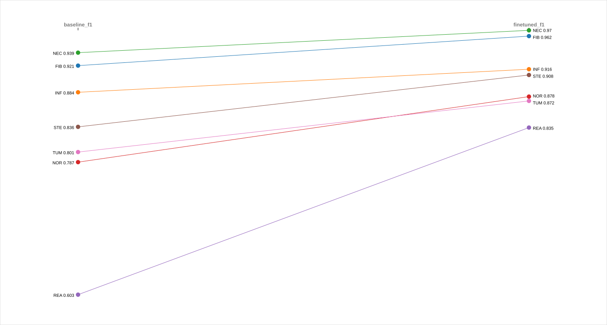
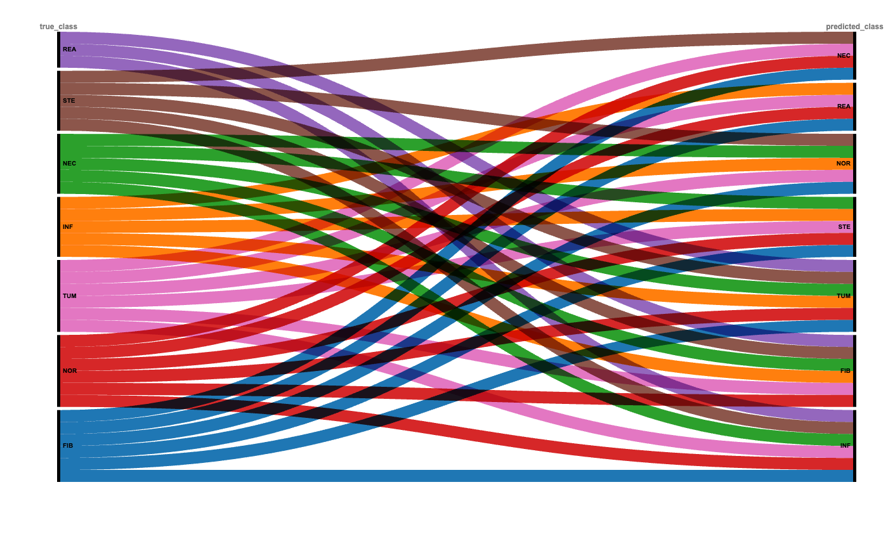
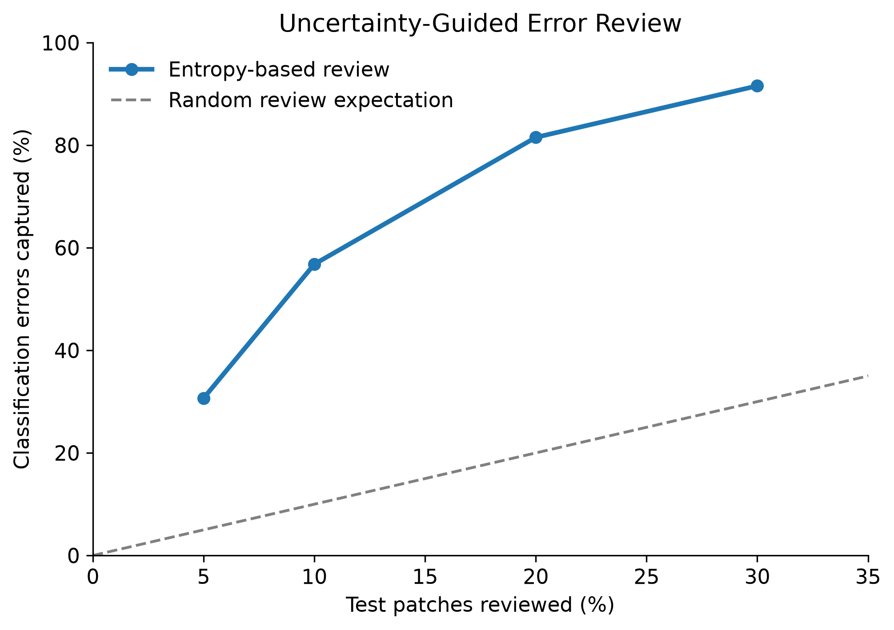

# LiverPath AI
### Uncertainty-Aware Deep Learning for Liver Histopathology

**PyTorch · ResNet-18 · Transfer Learning · Calibration · Predictive Entropy**

An exploratory deep-learning pipeline for seven-class liver
histopathology patch classification and uncertainty-guided
error prioritisation.

---

## Results at a Glance

| Metric | Final Test |
|---|---:|
| Accuracy | **92.92%** |
| Balanced accuracy | 91.34% |
| Macro-F1 | **0.9005** |
| Error-detection AUROC | 0.9079 |
| Error-detection AUPRC | 0.3928 |
| Calibrated ECE | 0.0062 |
| Errors captured at 10% review | **56.8%** |

**Test set:** 13,083 patches · 926 errors · 7 classes

---

## Experimental Pipeline

| Step | Method | Output |
|---|---|---|
| 01 | HepatoBench acquisition | 87,301 original patches |
| 02 | Integrity and duplicate checks | 87,220 unique valid patches |
| 03 | Stratified patch-level split | 70% / 15% / 15% |
| 04 | Image preprocessing | 224 × 224 RGB inputs |
| 05 | ResNet-18 baseline | Frozen pretrained backbone |
| 06 | Selective fine-tuning | Layer 4 + classifier |
| 07 | Model comparison | Validation macro-F1 |
| 08 | Uncertainty analysis | Predictive entropy |
| 09 | Probability calibration | Temperature scaling |
| 10 | Frozen protocol | Fixed checkpoint and review budget |
| 11 | Held-out test evaluation | Classification, calibration, uncertainty |
| 12 | Error analysis and visualisation | Confusion patterns and figures |

---

## 01 / Dataset Composition

**Dataset:** HepatoBench · H&E liver histopathology patches


| Class | Patches |
|---|---:|
| FIB — Fibrosis | 26,283 |
| INF — Inflammation | 4,776 |
| NEC — Necrosis | 22,023 |
| NOR — Normal tissue | 13,200 |
| REA — Biliary reaction | 1,540 |
| STE — Steroidal degeneration | 6,198 |
| TUM — Tumour | 13,200 |
| **Total** | **87,220** |

**Splits:** Train 61,054 · Validation 13,083 · Test 13,083

---

## 02 / Fine-Tuning Results



| Metric | Baseline | Fine-tuned |
|---|---:|---:|
| Validation accuracy | 87.05% | **92.88%** |
| Validation macro-F1 | 0.8245 | **0.9057** |
| Validation errors | 1,694 | **931** |

**Largest class improvement:** REA validation F1,
0.6028 → 0.8350.

---

## 03 / Final Test Classification

| Class | Precision | Recall | F1 |
|---|---:|---:|---:|
| FIB | 0.9777 | 0.9460 | 0.9616 |
| INF | 0.8521 | 0.9413 | 0.8945 |
| NEC | 0.9563 | 0.9809 | 0.9685 |
| NOR | 0.8680 | 0.9066 | 0.8869 |
| REA | 0.7391 | 0.8831 | 0.8047 |
| STE | 0.9359 | 0.8796 | 0.9069 |
| TUM | 0.9065 | 0.8566 | 0.8808 |

### Where Did the Model Make Mistakes?



**Largest test-set confusion patterns:**

| True → Predicted | Errors |
|---|---:|
| TUM → NOR | 173 |
| NOR → TUM | 114 |
| FIB → NEC | 114 |
| STE → NOR | 76 |
| NEC → FIB | 50 |

*Alluvial ribbons represent incorrect predictions only
(926 test errors).*

---

## 04 / Uncertainty-Guided Review



| Review budget | Errors captured | Errors remaining |
|---|---:|---:|
| 5% | 30.67% | 642 |
| **10%** | **56.80%** | **400** |
| 20% | 81.53% | 171 |
| 30% | 91.58% | 78 |

**Key finding:** Reviewing the 10% most uncertain test
patches identified 526 of 926 classification errors.

**Method:** Shannon entropy of predicted class probabilities.

---

## 05 / Calibration

Temperature scaling was fitted using validation data
and fixed before final test evaluation.

**Temperature:** 1.0833

| Metric | Before | After |
|---|---:|---:|
| Test ECE | 0.00842 | **0.00617** |
| Test NLL | 0.20820 | **0.20724** |
| Test Brier score | 0.10557 | 0.10557 |

Calibration improved modestly without changing predicted
class labels.

---

## 06 / Reproducibility

**Environment:** Python · PyTorch · torchvision · scikit-learn

```bash
python -m venv .venv
source .venv/bin/activate
pip install -r requirements.txt
```

The numbered scripts in `scripts/` document the experimental
workflow. Dataset acquisition, preprocessing and training
must be completed before downstream evaluation.

Raw image data and trained checkpoints are not distributed
in this repository.

---

## 07 / Scientific Limitations

- Splits are patch-level, not patient-level.
- Patient and slide identifiers were unavailable.
- Spatial or source-related overlap cannot be ruled out.
- Model selection used validation data.
- Test results do not establish external generalisation.
- Uncertainty-based review was evaluated retrospectively.

**Research prototype only — not for clinical diagnosis.**

---

## Dataset Attribution

**HepatoBench:** `xtxx/HepatoBench` on Hugging Face

Dataset licence: CC BY 4.0

https://huggingface.co/datasets/xtxx/HepatoBench


---

## Full Research Report

📄 **[Read the Complete LiverPath AI Research Report](docs/LiverPath_AI_Research_Report.pdf)**

Complete methodology, experimental results, model evaluation,
uncertainty quantification, calibration and scientific limitations.
